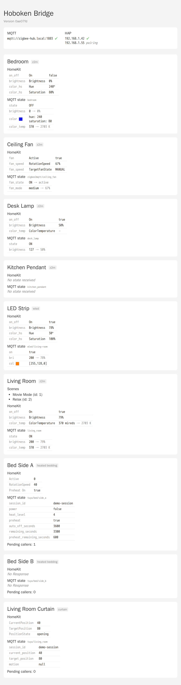

# Hoboken

A minimal HomeKit bridge for Zigbee2MQTT and WLED. Exposes Z2M lights, ceiling
fans, smart plugs, scenes, and WLED LED controllers to Apple Home for HomePod
and Siri voice commands.

Tucson's MQTT profile adds support for heated mattress pads and heated blankets
(heated bedding). Each configured zone appears as a ten-level fan and a
separate stateful preheat switch, with short display names such as "Bed Side A"
and "Bed Side A Preheat".

It also provides an HTTP endpoint with a live-updating dashboard presenting all
data in both MQTT and HAP forms, as well as Prometheus metrics and health check
endpoints.



Note that Hoboken is a HAP bridge, not a client. It provides bidirectional
control of MQTT devices and scenes to HomeKit. It does not provide control of
HomeKit-only devices (e.g., Ecobee thermostats) from MQTT. That would be a
different project.

## Why

Matterbridge and Homebridge are too complex and hard to troubleshoot. Hoboken does one
thing: bridge MQTT devices to HomeKit. It's built directly on
[`hap-nodejs`](https://github.com/homebridge/HAP-NodeJS).

It does not have any device discovery, self-update, or plugins. You get exactly what
you configure, and you will always get that.

All dependencies are pure JS/TS code. Test coverage is enforced at 100%
line, function, and statement coverage.

The deployment is a reproducible, distroless container image. You can
run it on K3s or whatever.

It's called "Hoboken" because that has some of the same letters as
"HomeKit Bridge".

### Modules

| Module               | Responsibility                        |
| -------------------- | ------------------------------------- |
| `src/config.ts`      | Load and validate YAML config         |
| `src/convert.ts`     | Value conversion (Z2M/WLED ↔ HomeKit) |
| `src/accessories.ts` | Create HAP accessories and scenes     |
| `src/bridge.ts`      | MQTT client, bridge wiring, lifecycle |
| `src/metrics.ts`     | Prometheus metrics and HTTP server    |
| `src/main.ts`        | Entry point                           |

Modules are split for testability. Each has clear inputs/outputs and minimal
coupling. Accessory creation takes injected `publish`/`getState` functions
rather than an MQTT client directly.

### Device Types

Each device has a `type` field (defaults to `"z2m"`) that selects the MQTT
protocol:

| Type   | Protocol              | MQTT Format                   |
| ------ | --------------------- | ----------------------------- |
| `z2m`  | Zigbee2MQTT (default) | JSON on `<topic>`             |
| `wled` | WLED MQTT API         | Sub-topics `/g`, `/c`, `/api` |

### Capabilities

Devices declare capabilities in `config.yaml`:

| Capability   | HomeKit Characteristic             | Z2M Conversion               | WLED Conversion            |
| ------------ | ---------------------------------- | ---------------------------- | -------------------------- |
| `on_off`     | `On`                               | boolean, always present      | boolean                    |
| `brightness` | `Brightness`                       | Z2M 0–254 ↔ HomeKit 0–100    | WLED 0–255 ↔ HomeKit 0–100 |
| `color_temp` | `ColorTemperature`                 | mireds, no conversion needed | not supported              |
| `color_hs`   | `Hue` + `Saturation`               | ranges match, no conversion  | HSV ↔ RGB conversion       |
| `fan`        | `Active` (FanV2)                   | `fan_state` ON/OFF ↔ 1/0     | not supported              |
| `fan_speed`  | `RotationSpeed` + `TargetFanState` | `fan_mode` ↔ speed thirds    | not supported              |

### Scenes

Scenes are exposed as momentary switches. "Hey Siri, turn on Movie Mode"
publishes `{"scene_recall": <id>}` to Z2M. The switch auto-resets to off after
1 second.

### Heated Bedding Zones

Configure heated mattress pad or heated blanket zones separately from `devices`:

```yaml
heatedBedding:
  - name: "Bed Side A"
    prefix: "tuya"
    controller: "bed"
    zone: "side_a"
  - name: "Bed Side B"
    prefix: "tuya"
    controller: "bed"
    zone: "side_b"
```

Match these logical names to Tucson's configuration. A bridge with only heated bedding
can omit `devices` or set it to `[]`. Controller/zone pairs must be unique
even across prefixes, because they determine accessory identities. Display
names and prefixes can change without changing those identities. Heated bedding
configuration contains only these four fields; Tucson owns controller
credentials, protocol versions, and device connections.

The fan's Active control changes power. RotationSpeed zero turns power off
and preserves the selected level; positive values select levels 1–10 in
10% steps. The reported speed retains that selected level while power is
off. An explicit off takes precedence over other fan writes arriving in
the same 50 ms window. Preheat follows its reported Boolean until the
controller changes it.

Writes wait for a confirmed command result and reported state that matches
it. Once a newer write to the same zone has been sent, the confirmed result
alone suffices, and the write returns the current reported state. Failed or
expired writes return a HomeKit error and retain reported
values. MQTT reconnection cancels pending writes and requires current
subscriptions, a fresh session heartbeat, online availability, and known
state. Commands are never replayed after reconnection. Existing Zigbee2MQTT
and WLED devices use their existing MQTT connection and conversion rules.

Physical side mapping and controller compatibility still require hardware
qualification. Actual Home app and Siri testing remains part of that
qualification.

### Failure Handling

- **MQTT disconnect**: `onSet` throws `HapStatusError(SERVICE_COMMUNICATION_FAILURE)`
  → HomeKit shows "No Response"
- **Unknown device state**: `onGet` throws `HapStatusError(SERVICE_COMMUNICATION_FAILURE)`
  when no cached state exists → HomeKit shows "Not Responding" until real state
  arrives. Z2M devices recover quickly because the bridge requests state via
  `{topic}/get` on connect. WLED devices require **Retain** enabled in WLED's
  MQTT settings (`Settings → Sync Interfaces → MQTT → Send on change → Retain`)
  so the broker delivers the last `/g` and `/c` values when the bridge subscribes.
  Without retain, the bridge has no way to learn the device's current state at
  startup.
- **MQTT reconnect**: re-subscribes and refreshes state automatically
- **Config changes**: restart the container (no hot reload)

### Metrics

Opt-in Prometheus metrics via `prom-client`. Add a `metrics` section to
`config.yaml` with a `port` to enable.

| Metric                                  | Type    | Labels   |
| --------------------------------------- | ------- | -------- |
| `hoboken_mqtt_connected`                | Gauge   |          |
| `hoboken_mqtt_messages_received_total`  | Counter | `device` |
| `hoboken_mqtt_messages_published_total` | Counter |          |
| `hoboken_mqtt_errors_total`             | Counter |          |
| `hoboken_devices_configured`            | Gauge   |          |

Default Node.js process metrics (CPU, memory, event loop lag) are also included.
The `k8s/deployment.yaml` includes Prometheus scrape annotations.

#### Status Page

When metrics are enabled, `GET /` serves an HTML status page showing:

- Bridge name and version
- MQTT connection status and active HAP connection count
- Each device with its topic, capabilities, scenes, and current state

This is useful for quick diagnostics without checking logs or Prometheus.
The page loads new data in real time using SSE.

To preview the status page with sample data:

```sh
make demo
```

## Config

```yaml
bridge:
  name: "Hoboken"
  mac: "AA:BB:CC:DD:EE:FF" # generate a unique MAC for your bridge
  pincode: "123-45-678" # change this before pairing
  port: 51826
  bind: "eno1" # optional: network interface for mDNS (needed in k8s with hostNetwork)

mqtt:
  url: "mqtt://mosquitto:1883"

# metrics:
#   port: 9090
#   bind: "127.0.0.1" # optional: defaults to 0.0.0.0

devices:
  - name: "Living Room Light"
    topic: "zigbee2mqtt/living_room_light"
    capabilities: [on_off, brightness, color_temp]
    scenes:
      - name: "Movie Mode"
        id: 1

  - name: "Bedroom Light"
    topic: "zigbee2mqtt/bedroom_light"
    capabilities: [on_off, brightness, color_hs]

  - name: "Ceiling Fan"
    topic: "zigbee2mqtt/ceiling_fan"
    capabilities: [fan, fan_speed]

  - name: "LED Strip"
    type: wled
    topic: "wled/living-room"
    capabilities: [on_off, brightness, color_hs]
```

Neither `mac` nor `pincode` are secrets. The MAC is broadcast via mDNS.
The PIN is only used during initial pairing and is not reusable afterward.

### Bind Interface

The optional `bind` field restricts the HAP server and mDNS advertisement to a
specific network interface. Without it, hap-nodejs advertises on all interfaces,
which in Kubernetes with `hostNetwork: true` can cause mDNS to advertise a
cluster-internal IP (e.g., `cni0`) instead of the LAN IP. Set `bind` to the
host's LAN interface name (e.g., `eno1`) so HomeKit clients can reach the bridge.

### MAC and PIN Generation

The bridge MAC must be a locally-administered unicast address (bit 1 of the
first octet set, bit 0 clear). The PIN is 8 random digits formatted as
`XXX-XX-XXX` and must not be a HAP-excluded value (`000-00-000`,
`111-11-111` … `999-99-999`, `123-45-678`, `876-54-321`).

Generate both with (the PIN is redrawn until it is not an excluded value):

```sh
python3 -c "import random; b=random.randbytes(6); excluded={d*8 for d in '0123456789'}|{'12345678','87654321'}; p=next(s for s in iter(lambda: ''.join(random.choices('0123456789',k=8)), None) if s not in excluded); print(f'MAC: {(b[0]|2)&~1:02X}:{b[1]:02X}:{b[2]:02X}:{b[3]:02X}:{b[4]:02X}:{b[5]:02X}'); print(f'PIN: {p[0:3]}-{p[3:5]}-{p[5:8]}')"
```

### Z2M Groups as Devices

Hoboken can target Z2M groups by using the group's friendly name as the device
topic. Commands are broadcast to all group members at the Zigbee level. Devices
that don't support a given cluster silently ignore it, so capabilities should
match the most capable member. This is preferable to homebridge-z2m's approach
of intersecting capabilities.

## Development

### Prerequisites

- [Bun](https://bun.sh/) (package manager and test runner)
- Node.js 26+ (runtime, for TypeScript type stripping)
- Make (task runner)
- A C compiler, CMake, OpenSSL headers, and cJSON headers for integration tests
- A C++ toolchain and Python, only where re2 (Renovate's regex engine, used by
  `make lint`) has no prebuilt binary for the platform and Node.js version

### Setup

```sh
make setup
```

Run it under the Node.js that `make lint` will use, because it installs re2 for
that Node.js version.

### Commands

```sh
make lint    # Type checking, ESLint, Renovate config validation, Prettier
make test    # Run tests with coverage
make run     # Run with Node.js
```

On Debian or Ubuntu, install the broker build packages with
`make test-broker-deps`. Then run `make test-integration` on Node.js 26.
The target builds the pinned Mosquitto release and runs the existing WLED
tests plus heated bedding tests over paired HAP HTTP and MQTT 5 connections.
Use `NODE=/path/to/node make test-integration` to select the runtime.

Heated bedding integration covers reported state on both zones, fan-write
ordering, stateful preheat, rejected and retained results, session changes,
the full HAP write deadline, and broker restart without command replay.
The simulated MQTT controller exercises the contract; actual Sunbeam, Home
app, and Siri qualification still requires hardware.

To qualify the complete controller path, run Tucson's `make homekit` target
with `HOBOKEN_SOURCE` set to this checkout and `NODE` set to Node.js 26.
The `integration/tucson-roundtrip.ts` driver pairs through HAP HTTP and
checks writes, controller-originated updates, and Tucson shutdown. Both
repositories require their frozen dependencies; missing prerequisites fail
qualification.

## Deployment

### Container

```sh
docker build -t hoboken .
```

Multi-stage build: Bun installs deps, distroless Node.js 26 runs the app.
Image: `gcr.io/distroless/nodejs26-debian13` (no shell, minimal attack surface).

### Kubernetes

Deployed on k3s via [Flux](https://fluxcd.io/). The manifests in `k8s/` are
reconciled automatically.

- `hostNetwork: true` — required for mDNS (HomeKit device discovery)
- `strategy: Recreate` — single instance (MAC uniqueness)
- PVC at `/persist` — pairing data survives restarts
- ConfigMap at `/config/config.yaml`

### Pairing with Apple Home

1. Open the **Home** app on your iPhone or iPad.
2. Tap **+** (top right) → **Add Accessory**.
3. Tap **More options…** at the bottom. "Hoboken" should appear via mDNS.
4. Select it, then enter the PIN from your config (e.g., `482-37-159`).
5. Assign the bridge to a room when prompted.

The PIN is only used during the initial pairing. After that, the pairing keys
stored in `/persist` authenticate all communication. If you delete the PVC or
change the MAC, you must remove the bridge from Home and re-pair.

### Troubleshooting

Verify mDNS advertisement from a Mac on the same network:

```sh
dns-sd -B _hap._tcp
```

Check that the HAP port is reachable from the network:

```sh
nc -z <node-ip> 51826
```

View logs for pairing diagnostics:

```sh
kubectl -n hoboken logs deploy/hoboken
```

The bridge logs lifecycle events: MQTT connection state, HAP server listening
address, mDNS advertisement, identify requests, pair-setup completion, and
connection close events.

### Tucson curtains

The optional `curtains` configuration presents Tucson endpoints as HomeKit
window coverings:

```yaml
curtains:
  - name: Living Room Curtain
    prefix: tuya
    controller: living_room
    zone: curtain
```

A curtain-only bridge may omit `devices` or set it to `[]`. Each entry uses the
same logical topic naming rules as `heatedBedding`; routes must not overlap.
No Tuya credentials belong in Hoboken.

Set `TargetPosition` from zero (closed) to 100 (open). `CurrentPosition` comes
from device reports. `PositionState` uses reported motion when available and
otherwise compares reported current and target positions. This inference
cannot detect a motor stalled away from its target. Start/stop controls and
HomeKit `HoldPosition` are not exposed.

Target writes complete after Tucson confirms device acceptance, before the
curtain necessarily finishes moving. Missing positions, stale sessions, or
unavailable controllers produce “No Response.” The status page displays
reported state and pending callers.

This is infrastructure for future Zemismart Wi-Fi curtain support. Tucson does
not yet register a production Zemismart profile; the physical model and
mapping must be qualified first. Its
[curtain contract](https://github.com/shields/tucson/blob/main/docs/implementation-plan.md#curtain-infrastructure)
defines the MQTT interface. `make homekit` in Tucson exercises the synthetic
curtain profile through both bridges and paired HomeKit clients.
