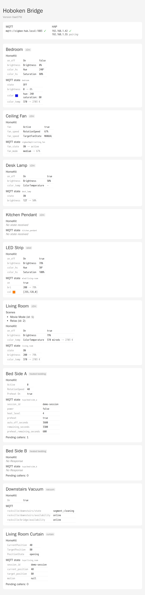

# Hoboken

A minimal HomeKit bridge for Zigbee2MQTT and WLED. Exposes Z2M lights, ceiling
fans, smart plugs, scenes, and WLED LED controllers to Apple Home for HomePod
and Siri voice commands.

[Tucson](https://github.com/shields/tucson), a separate service that owns the
device connections, adds heated mattress pads and heated blankets (heated
bedding) over its MQTT profile, each zone or group of zones as a ten-level fan
and a preheat switch, and a Zemismart BCD300FB Wi-Fi curtain motor as a window
covering.

It also provides an HTTP endpoint with a live-updating dashboard presenting all
data in both MQTT and HAP forms, as well as Prometheus metrics and health check
endpoints.



Note that Hoboken is a HAP bridge, not a client. It provides bidirectional
control of MQTT devices and scenes to HomeKit. It does not provide control of
HomeKit-only devices (e.g., Ecobee thermostats) from MQTT. That would be a
different project.

## Why

Matterbridge and Homebridge are too complex and hard to troubleshoot. Hoboken does one
thing: bridge MQTT devices to HomeKit. It's built directly on
[`hap-nodejs`](https://github.com/homebridge/HAP-NodeJS).

It does not have any device discovery, self-update, or plugins. You get exactly what
you configure, and you will always get that.

All dependencies are pure JS/TS code. Test coverage is enforced at 100%
line, function, and statement coverage. The deployment is a reproducible,
distroless container image. You can run it on K3s or whatever.

It's called "Hoboken" because that has some of the same letters as
"HomeKit Bridge".

## Devices

Each device has a `type` field (defaults to `"z2m"`) that selects the MQTT
protocol:

| Type   | Protocol              | MQTT Format                   |
| ------ | --------------------- | ----------------------------- |
| `z2m`  | Zigbee2MQTT (default) | JSON on `<topic>`             |
| `wled` | WLED MQTT API         | Sub-topics `/g`, `/c`, `/api` |

Devices declare capabilities in `config.yaml`:

| Capability   | HomeKit Characteristic             | Z2M Conversion                           | WLED Conversion            |
| ------------ | ---------------------------------- | ---------------------------------------- | -------------------------- |
| `on_off`     | `On`                               | boolean, always present                  | boolean                    |
| `brightness` | `Brightness`                       | Z2M 0–254 ↔ HomeKit 0–100                | WLED 0–255 ↔ HomeKit 0–100 |
| `color_temp` | `ColorTemperature`                 | mireds, no conversion needed             | white segments only        |
| `color_hs`   | `Hue` + `Saturation`               | ranges match; white becomes `color_temp` | HSV ↔ RGB conversion       |
| `fan`        | `Active` (FanV2)                   | `fan_state` ON/OFF ↔ 1/0                 | not supported              |
| `fan_speed`  | `RotationSpeed` + `TargetFanState` | `fan_mode` ↔ speed thirds                | not supported              |

A Z2M group works as a device: use the group's friendly name as the topic.
Commands are broadcast to all group members at the Zigbee level, and devices
that don't support a given cluster ignore it, so give the group the
capabilities of its most capable member.

### White on color lights

"Set the lights to white" arrives from HomeKit as a color. For a Zigbee2MQTT
light that reports a `color_temp`, or that has `whiteColorTemp` or the
`color_temp` capability, Hoboken publishes a color temperature instead, so that
the bulb uses its white LEDs. On a light with Adaptive Lighting, Siri's white
is Adaptive Lighting's temperature: it keeps Adaptive Lighting on, and turns
it back on after a color or temperature
([doc/adaptive-lighting.md](doc/adaptive-lighting.md#siris-white)).
Otherwise white is the device's `whiteColorTemp` in mireds (1,000,000 /
kelvins, from 140 to 500), or 370 (2700 K) without one. Siri's "warm white" is
370 (2700 K) too and "cool white" 250 (4000 K), and its halogen and
fluorescents are temperatures as well. The Home app's Temperature tab and
white swatches become the temperature they stand for.

A Zigbee2MQTT light can have `color_temp` and `color_hs` together, which the
HomeKit specification does not allow but other bridges also do.

A WLED light gets RGB (255, 255, 255). For an RGBW strip, set Auto White
to "Accurate" in WLED's LED preferences to light the white LEDs alone.
A color or white from HomeKit sets each segment it lights to WLED's Solid
effect, because an effect such as Rainbow ignores the segment's color.

[doc/color-coalescing.md](doc/color-coalescing.md) has the rules and what the
Home app and Siri write.

### WLED white segments

A WLED fixture can have its white on segments of its own: an RGB strip on
one segment, and on others a four-channel driver whose channels feed warm
and cool white strips. Describe it with `colorSegments`, `whiteSegments`,
and `whiteChannels`, the color temperature in kelvins of the strip on each
channel, and it can have `color_temp`:

```yaml
- name: "Nook"
  type: wled
  topic: "wled/nook"
  capabilities: [on_off, brightness, color_temp, color_hs]
  colorSegments: [0]
  whiteSegments: [1, 2]
  whiteChannels: { r: 5500, g: 2400, b: 5500, w: 2400 }
  gamma: 2.2 # optional: WLED's color gamma setting
```

A color temperature or a white lights the white segments and turns the
color segments off; a color does the reverse. The range HomeKit offers is the
one the strips span, which must lie within 140 to 500 mireds (about 2000 to
7142 K). Auto White must be "None" on the white outputs. WLED reports the
color of the lowest-numbered selected segment, so deselect in WLED any
selected segment that is in neither list and has a lower id than the listed
ones.

### Adaptive Lighting

A light with both `brightness` and `color_temp` offers Adaptive Lighting in
the Home app, with no configuration. It needs a home hub, which runs the
schedule. A light that is off is kept at the current temperature, so that it
comes on at that temperature however it is turned on. A Zigbee2MQTT light
that is on fades to each new temperature over 5 seconds. Setting a color or a
temperature from HomeKit, or a color anywhere else, turns Adaptive Lighting
off, except Siri's white, which keeps it on and turns it back on. Adaptive
Lighting, and the last schedule from the hub that the white restores it from,
survive a restart if `PERSIST_PATH` is persistent.
[doc/adaptive-lighting.md](doc/adaptive-lighting.md) has the detail.

### Scenes

Scenes are exposed as momentary switches. "Hey Siri, turn on Movie Mode"
publishes `{"scene_recall": <id>}` to Z2M. The switch auto-resets to off after
1 second.

### Heated bedding

Configure heated mattress pad or heated blanket zones separately from
`devices`. An entry gives one `zone`, or `zones` to control several zones of
one controller as a group:

```yaml
heatedBedding:
  - name: "Michael Bed"
    prefix: "tuya"
    controller: "bed"
    zone: "side_a"
  - name: "Elizabeth Bed"
    prefix: "tuya"
    controller: "bed"
    zone: "side_b"
  - name: "Bed"
    prefix: "tuya"
    controller: "bed"
    zones: ["side_a", "side_b"]
```

Each zone or group appears as a ten-level fan and a stateful preheat switch.
Match the logical names to Tucson's configuration; Tucson owns controller
credentials, protocol versions, and device connections. A bridge with only
heated bedding can omit `devices`. An entry's controller and zone, or for a
group its controller and set of zones, identify its accessories, so they must
be unique even across prefixes, and renaming an entry or changing its prefix
keeps its accessories.

A group's fan is on while any of its zones is on, at the highest level among
them. Active on powers on each zone that is off, at its own stored level, and
every other write goes to every zone. A group write succeeds only when
every zone confirms it, and a group is unavailable ("No Response") while any of
its zones is.

A fan write that powers a zone on also sets its auto-off timer to six hours. A
preheat that turns a zone on leaves the controller's 10-hour default.

[doc/tucson.md](doc/tucson.md) has the identity rules, what each write does,
and how writes are confirmed.

### Curtains

The optional `curtains` configuration presents single-endpoint Tucson
controllers as HomeKit window coverings:

```yaml
curtains:
  - name: Living Room Curtain
    prefix: tuya
    controller: living_room
```

A curtain's state is on `<prefix>/<controller>` (`tuya/living_room` above),
without a zone. Set `TargetPosition` from zero (closed) to 100 (open);
start/stop controls and HomeKit `HoldPosition` are not exposed. Tucson supports
the Zemismart BCD300FB Wi-Fi motor; other models are not implied to work. See
[doc/tucson.md](doc/tucson.md).

### Vacuums

Each [Rockville](https://github.com/shields/rockville) vacuum appears as a
stateful switch. On starts cleaning. Off sends the vacuum to its dock, including
when it is paused and the switch already reads Off. A bridge with only vacuums
can omit `devices`.

```yaml
vacuums:
  - name: Downstairs Vacuum
    device: downstairs
```

Set `prefix` if Rockville uses a topic prefix other than `rockville`. The prefix
and device identify the accessory, so changing the display name preserves Home
automations. A write succeeds when Hoboken sends the command. Rockville polls
the vacuum immediately after executing it. Older releases report changes at
their regular polling interval.

The switch shows On during floor cleaning, including spot, zone, and room runs
started outside Home. It shows Off while paused, returning, or charging. Each
MQTT connection needs a recognized state and online availability reports from
both the vacuum and Rockville. Home shows No Response while any are missing or
either goes offline.

## Config

```yaml
bridge:
  name: "Hoboken"
  mac: "AA:BB:CC:DD:EE:FF" # generate a unique MAC for your bridge
  pincode: "123-45-678" # change this before pairing
  port: 51826
  bind: "eno1" # optional: network interface for mDNS (needed in k8s with hostNetwork)

mqtt:
  url: "mqtt://mosquitto:1883"
  # username: "hoboken" # optional: broker login; needs passwordFile
  # passwordFile: "/secrets/mqtt_password" # needs username

# metrics:
#   port: 9090
#   bind: "127.0.0.1" # optional: defaults to 0.0.0.0

devices:
  - name: "Living Room Light"
    topic: "zigbee2mqtt/living_room_light"
    capabilities: [on_off, brightness, color_temp]
    scenes:
      - name: "Movie Mode"
        id: 1

  - name: "Bedroom Light"
    topic: "zigbee2mqtt/bedroom_light"
    capabilities: [on_off, brightness, color_hs]
    # whiteColorTemp: 250 # optional: mireds for "white" without Adaptive Lighting; defaults to 370 (2700 K)

  - name: "Ceiling Fan"
    topic: "zigbee2mqtt/ceiling_fan"
    capabilities: [fan, fan_speed]

  - name: "LED Strip"
    type: wled
    topic: "wled/living-room"
    capabilities: [on_off, brightness, color_hs]
```

Neither `mac` nor `pincode` are secrets. The MAC is broadcast via mDNS.
The PIN is only used during initial pairing and is not reusable afterward.

### Supported keys

Hoboken refuses to start when any object in `config.yaml` has a key that is not
listed here, so a misspelled key cannot silently fall back to its default. A
misspelled `metrics.bind`, for example, would otherwise leave the status page
on every interface. The error gives the section and the key, such as
`metrics: unknown field "bnd"; supported fields are port and bind`, but never
the value.

| Object                     | Keys                                                                                                                            |
| -------------------------- | ------------------------------------------------------------------------------------------------------------------------------- |
| top level                  | `bridge`, `mqtt`, `devices`, `heatedBedding`, `curtains`, `vacuums`, `metrics`                                                  |
| `bridge`                   | `name`, `mac`, `pincode`, `port`, `bind`                                                                                        |
| `mqtt`                     | `url`, `username`, `passwordFile`                                                                                               |
| `metrics`                  | `port`, `bind`                                                                                                                  |
| each `devices` entry       | `name`, `type`, `topic`, `capabilities`, `whiteColorTemp`, `colorSegments`, `whiteSegments`, `whiteChannels`, `gamma`, `scenes` |
| `whiteChannels`            | `r`, `g`, `b`, `w`                                                                                                              |
| each `scenes` entry        | `name`, `id`                                                                                                                    |
| each `heatedBedding` entry | `name`, `prefix`, `controller`, `zone`, `zones`                                                                                 |
| each `curtains` entry      | `name`, `prefix`, `controller`                                                                                                  |
| each `vacuums` entry       | `name`, `device`, `prefix`                                                                                                      |

### Bind Interface

The optional `bind` field restricts the HAP server and mDNS advertisement to a
specific network interface. Without it, hap-nodejs advertises on all interfaces,
which in Kubernetes with `hostNetwork: true` can cause mDNS to advertise a
cluster-internal IP (e.g., `cni0`) instead of the LAN IP. Set `bind` to the
host's LAN interface name (e.g., `eno1`) so HomeKit clients can reach the bridge.

### MQTT broker

`mqtt.url` names the broker as `scheme://host[:port]`, such as
`mqtt://mosquitto:1883` or `mqtts://broker.example.com:8883`. The scheme is
`mqtt`, `mqtts`, `tcp`, `ssl`, `tls`, `ws`, or `wss`. Hoboken refuses to start
with `mqtt.url is not a valid MQTT URL` for a URL that mqtt.js could not connect
with as written, and never prints any part of the URL, because it can carry
credentials.

Brokers that require a login take `mqtt.username` and an `mqtt.passwordFile`
that names a file containing the password, with or without a trailing line
ending. The password comes from no other source: `mqtt.password` in
`config.yaml` is refused, and an `MQTT_PASSWORD` environment variable is
ignored. It never appears in logs, the status page, metrics, or error messages.
Use `mqtts://` unless the broker is on a trusted network, because `mqtt://`
sends the password unencrypted. Do not set `DEBUG` to a pattern that matches
the MQTT library, such as `DEBUG=*` or `DEBUG=mqtt*`, which makes it print the
password.

[doc/mqtt.md](doc/mqtt.md) has the URL forms that are refused, the password
file rules, credentials embedded in the URL, the topics that a broker with
per-user permissions must grant, and what a refused connection or subscription
looks like.

### MAC and PIN Generation

The bridge MAC must be a locally-administered unicast address (bit 1 of the
first octet set, bit 0 clear). The PIN is 8 random digits formatted as
`XXX-XX-XXX` and must not be a HAP-excluded value (`000-00-000`,
`111-11-111` … `999-99-999`, `123-45-678`, `876-54-321`).

Generate both with (the PIN is redrawn until it is not an excluded value):

```sh
python3 -c "import random; b=random.randbytes(6); excluded={d*8 for d in '0123456789'}|{'12345678','87654321'}; p=next(s for s in iter(lambda: ''.join(random.choices('0123456789',k=8)), None) if s not in excluded); print(f'MAC: {(b[0]|2)&~1:02X}:{b[1]:02X}:{b[2]:02X}:{b[3]:02X}:{b[4]:02X}:{b[5]:02X}'); print(f'PIN: {p[0:3]}-{p[3:5]}-{p[5:8]}')"
```

## Operation

### Failure Handling

- **MQTT disconnect**: `onSet` throws `HapStatusError(SERVICE_COMMUNICATION_FAILURE)`
  → HomeKit shows "No Response"
- **Unknown device state**: `onGet` throws the same error when no cached state
  exists → HomeKit shows "Not Responding" until real state arrives. Z2M devices
  recover quickly because the bridge requests state via `{topic}/get` on
  connect. WLED devices require **Retain** enabled in WLED's MQTT settings
  (`Settings → Sync Interfaces → MQTT → Send on change → Retain`) so the broker
  delivers the last `/g` and `/c` values when the bridge subscribes.
- **MQTT reconnect**: re-subscribes and refreshes state automatically. The
  shared Zigbee2MQTT, WLED, and Rockville connection waits 1 second before the first retry and
  doubles the wait up to 60 seconds.
- **Broker refusals**: that connection logs a refused login as
  `MQTT error: Connection refused: ...` and retries with the same backoff, so
  correcting the broker takes effect without a restart. It logs a refused
  subscription as `MQTT subscription refused for ...` and stays up, and the
  refused devices report no state. See
  [doc/mqtt.md](doc/mqtt.md#refused-connections-and-subscriptions), also for
  the heated bedding and curtain connections.
- **Malformed `mqtt.url` or inconsistent credentials**: exit at startup
- **Config changes**: restart the container (no hot reload)

### Metrics

Opt-in Prometheus metrics via `prom-client`. Add a `metrics` section to
`config.yaml` with a `port` to enable. The server answers `/metrics`,
`/healthz`, and `/readyz`.

| Metric                                  | Type    | Labels   |
| --------------------------------------- | ------- | -------- |
| `hoboken_mqtt_connected`                | Gauge   |          |
| `hoboken_mqtt_messages_received_total`  | Counter | `device` |
| `hoboken_mqtt_messages_published_total` | Counter |          |
| `hoboken_mqtt_errors_total`             | Counter |          |
| `hoboken_devices_configured`            | Gauge   |          |
| `hoboken_devices_state_unknown`         | Gauge   |          |
| `hoboken_hap_connections_active`        | Gauge   |          |
| `hoboken_hap_pair_verify_total`         | Counter |          |
| `hoboken_z2m_get_requests_total`        | Counter |          |

Default Node.js process metrics (CPU, memory, event loop lag) are also included.
`k8s/deployment.yaml` has Prometheus scrape annotations to uncomment.

When metrics are enabled, `GET /` serves an HTML status page showing the
bridge name and version, MQTT
connection status, the active HAP connection count, and each device with its
topic, capabilities, scenes, and current state. It loads new data in real time
using SSE. To preview it with sample data, run `make demo`.

## Deployment

### Container

```sh
docker build -t hoboken .
```

Multi-stage build: Bun installs deps, distroless Node.js 26 runs the app.
Image: `gcr.io/distroless/nodejs26-debian13` (no shell, minimal attack surface).

The bridge reads its configuration from `CONFIG_PATH` (default
`/config/config.yaml`) and stores pairing data in `PERSIST_PATH` (default
`/persist`).

### Kubernetes

Deployed on k3s via [Flux](https://fluxcd.io/). The manifests in `k8s/` are
reconciled automatically.

- `hostNetwork: true` — required for mDNS (HomeKit device discovery)
- `strategy: Recreate` — single instance (MAC uniqueness)
- PVC at `/persist` — pairing data survives restarts
- ConfigMap at `/config/config.yaml`
- Optional Secret for the MQTT password: mount it read-only, but not at `/run`,
  `/var/run`, `/run/secrets`, or `/var/run/secrets`, and name its file in
  `mqtt.passwordFile`

### Pairing with Apple Home

1. Open the **Home** app on your iPhone or iPad.
2. Tap **+** (top right) → **Add Accessory**.
3. Tap **More options…** at the bottom. "Hoboken" should appear via mDNS.
4. Select it, then enter the PIN from your config (e.g., `482-37-159`).
5. Assign the bridge to a room when prompted.

After the initial pairing, the pairing keys stored in `/persist` authenticate
all communication. If you delete the PVC or change the MAC, you must remove the
bridge from Home and re-pair.

### Troubleshooting

```sh
dns-sd -B _hap._tcp                     # mDNS advertisement, from a Mac on the same network
nc -z <node-ip> 51826                   # HAP port reachable from the network
kubectl -n hoboken logs deploy/hoboken  # connection, pairing, and write logs
```

To see what the Home app and Siri read and write, set
`DEBUG=HAP-NodeJS:Accessory,HAP-NodeJS:Characteristic` in the container's
environment. HAP-NodeJS then logs each characteristic read and write request
(`Processing characteristic set: ...`), and the reason it rejects a value, such
as a Zigbee2MQTT fan speed above 100, which the bridge never sees. Unset it
afterwards, because it logs every request. Do not widen the pattern, which can
make the MQTT library print the password.

## Development

Prerequisites:

- [Bun](https://bun.sh/) (package manager and test runner)
- Node.js 26+ (runtime, for TypeScript type stripping)
- Make (task runner)
- A C compiler, CMake, OpenSSL headers, and cJSON headers for integration tests
- A C++ toolchain and Python, only where re2 (Renovate's regex engine, used by
  `make lint`) has no prebuilt binary for the platform and Node.js version

```sh
make setup   # Install dependencies and the pre-commit hook
make lint    # Type checking, ESLint, Renovate config validation, Prettier
make test    # Run tests with coverage
make run     # Run with Node.js
```

Run `make setup` under the Node.js that `make lint` will use, because it
installs re2 for that Node.js version.

On Debian or Ubuntu, install the broker build packages with
`make test-broker-deps`. Then run `make test-integration` on Node.js 26. The
target builds the pinned Mosquitto release and runs the round trips in
`integration/` through it: WLED, heated bedding over paired HAP HTTP and MQTT 5
connections, Rockville vacuum switches over paired HAP and MQTT, a broker that
requires a login and restricts topics, brokers that refuse subscriptions or drop
every session, and a malformed `mqtt.url`. Use
`NODE=/path/to/node make test-integration` to select the runtime. The simulated
MQTT controller exercises the contract; actual Sunbeam, Home app, and Siri
qualification still requires hardware.

To qualify the complete controller path, run Tucson's `make homekit` target
with `HOBOKEN_SOURCE` set to this checkout and `NODE` set to Node.js 26. The
`integration/tucson-roundtrip.ts` driver pairs through HAP HTTP and checks
writes, controller-originated updates, and Tucson shutdown. Both repositories
require their frozen dependencies; missing prerequisites fail qualification.
